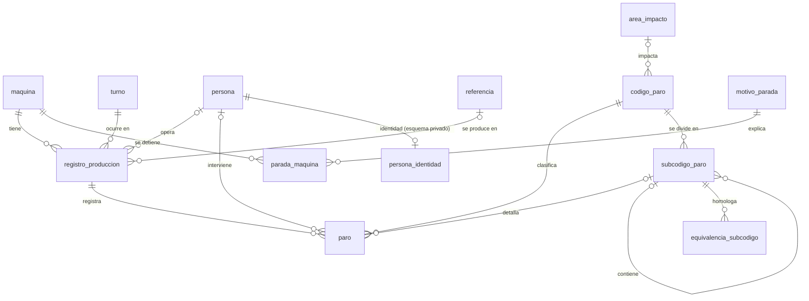

# Base de datos de paros de produccion (lineas de envasado de vinilos)

Proyecto final de **Bases de Datos I** (I.U. Pascual Bravo). Reemplaza el libro de Excel `SEGUIMIENTO TEMPERAS Y VINILOS` por una base de datos relacional normalizada (PostgreSQL) que registra la produccion y los paros de las maquinas Vinilos_1 a Vinilos_4 y reproduce los indicadores del procedimiento **P-MTO-22**.

**Integrantes:** Emmanuel Echeverri Quintero y Camilo Velasquez Botero

## Que contiene
- Modelo conceptual (MER), modelo relacional y proceso de normalizacion hasta 3FN/BCNF.
- Esquema SQL con 12 tablas en el esquema `paros` y 1 en `privado`, llaves, restricciones, 10 indices y 7 vistas.
- Migracion de 8.208 filas historicas del Excel (enero de 2022 a marzo de 2025) con verificacion de integridad.
- 19 consultas de negocio (productividad por maquina y mes, participacion por codigo, detalle por subcodigo, comparacion entre turnos, etc.).
- Proteccion de datos personales: seudonimos + esquema privado + roles.

## Modelo (resumen)

Diagramas completos en `docs/diagramas/`.

## Estructura del repositorio
```
.
├── README.md
├── .gitignore
├── sql/                      scripts en el orden en que se ejecutan
│   ├── 00_crear_base.sql         crea la base bdi_paros
│   ├── 01_esquema.sql            tablas, PK, FK, UNIQUE, CHECK, DEFAULT
│   ├── 02_indices.sql
│   ├── 03_vistas.sql
│   ├── 04_catalogos.sql          maquinas, turnos, codigos, subcodigos, motivos, referencias, personas (seudonimos)
│   ├── 05_migracion_datos.sql    registros, paros y paradas historicas
│   ├── 06_seguridad.sql          roles y permisos
│   ├── 07_pruebas_restricciones.sql   INSERT/UPDATE/DELETE correctos y rechazados
│   ├── 08_consultas_negocio.sql
│   └── 09_verificacion_integridad.sql
├── etl/                      script de migracion Excel -> SQL (Python)
├── data/                     CSV equivalentes (seudonimizados)
└── docs/                     analisis, diagnostico, modelos, normalizacion, diccionario, datos personales, migracion, consultas
```

## Como reproducir la base desde cero (DBeaver + PostgreSQL 14 o superior)
1. Crear la base: en DBeaver, conexion a PostgreSQL > clic derecho en *Databases* > *Create New Database* con nombre `bdi_paros` (o ejecutar `sql/00_crear_base.sql` conectado a la base `postgres`).
2. Abrir una conexion a `bdi_paros`.
3. Ejecutar **como script** (*SQL Editor > Execute SQL Script*, `Alt+X`) los archivos en este orden: `01_esquema.sql`, `02_indices.sql`, `03_vistas.sql`, `04_catalogos.sql`, `05_migracion_datos.sql` (el 05 pesa 1,1 MB; puede tardar unos segundos), `06_seguridad.sql`.
4. Verificar la carga: `09_verificacion_integridad.sql` (todas las filas deben decir `OK`).
5. Explorar: `08_consultas_negocio.sql` y `07_pruebas_restricciones.sql` (este ultimo se ejecuta sentencia por sentencia; las marcadas `[FALLA]` deben dar error).

El script `01_esquema.sql` se puede repetir: borra y recrea los esquemas `paros` y `privado`.

## Datos personales
Los nombres reales no estan en este repositorio. Las personas aparecen como `OPE-001`, `MAN-001`, etc. Ver `docs/07_datos_personales.md`.

## Documentacion
| Documento | Contenido |
|---|---|
| `docs/01_analisis_y_reglas_de_negocio.md` | Entidades, atributos y reglas de negocio |
| `docs/02_diagnostico_excel.md` | Problemas del Excel y consecuencias |
| `docs/03_modelo_conceptual.md` | MER, cardinalidades y participacion |
| `docs/04_modelo_relacional.md` | Modelo logico y politicas ON DELETE / ON UPDATE |
| `docs/05_normalizacion.md` | UNF -> 1FN -> 2FN -> 3FN -> BCNF |
| `docs/06_diccionario_datos.md` | Tablas y columnas |
| `docs/07_datos_personales.md` | Manejo de nombres de personal |
| `docs/08_migracion.md` | Estrategia y evidencia de integridad |
| `docs/09_consultas.md` | Consultas y resultados |
