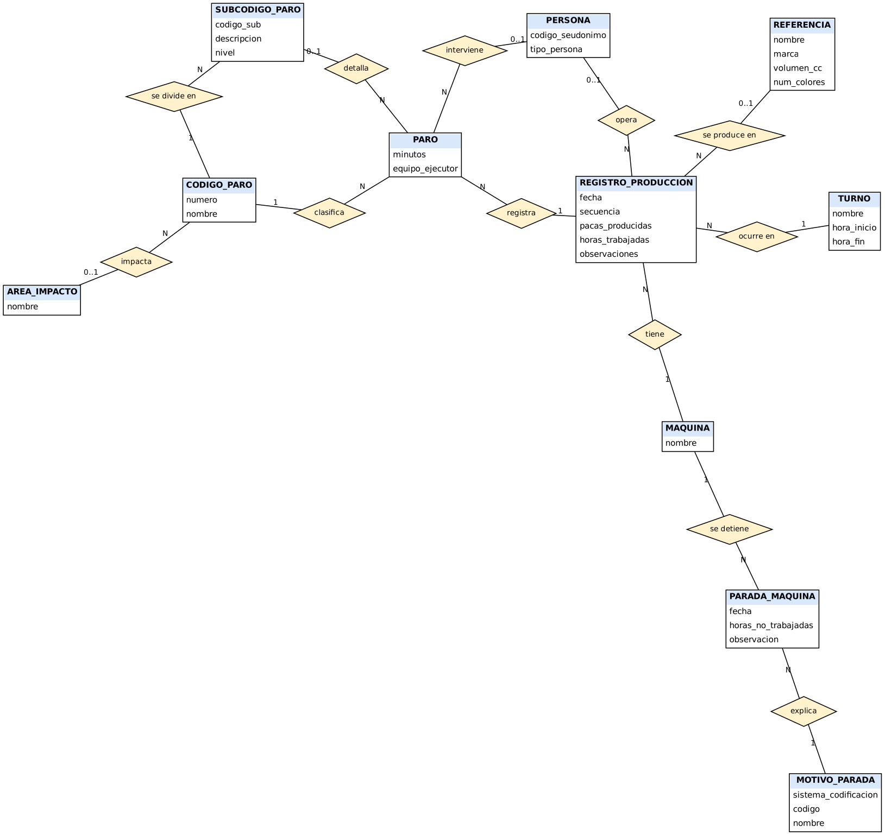

# 3. Modelo conceptual (MER)

Notacion: diagrama entidad-relacion con rombos para las relaciones. Cardinalidad escrita en cada extremo (1, 0..1, N). Diagrama: `docs/diagramas/modelo_conceptual.png` (fuente en `modelo_conceptual.dot`).

## Relaciones, cardinalidades y participacion

| Relacion | Entidad A | Entidad B | Cardinalidad (A : B) | Participacion |
|---|---|---|---|---|
| tiene | MAQUINA | REGISTRO_PRODUCCION | 1 : N | Registro total (obligatoria); maquina parcial |
| ocurre en | TURNO | REGISTRO_PRODUCCION | 1 : N | Registro total (si no se conoce, turno `SIN ESPECIFICAR`) |
| opera | PERSONA | REGISTRO_PRODUCCION | 0..1 : N | Registro parcial (en 2022-2023 no se anotaba la operaria) |
| se produce en | REFERENCIA | REGISTRO_PRODUCCION | 0..1 : N | Registro parcial |
| registra | REGISTRO_PRODUCCION | PARO | 1 : N | Paro total (no existe sin registro); registro parcial (puede no tener paros) |
| clasifica | CODIGO_PARO | PARO | 1 : N | Paro total |
| detalla | SUBCODIGO_PARO | PARO | 0..1 : N | Paro parcial (solo codigos 01, 03, 05) |
| interviene | PERSONA | PARO | 0..1 : N | Paro parcial |
| se divide en | CODIGO_PARO | SUBCODIGO_PARO | 1 : N | Subcodigo total |
| contiene (recursiva) | SUBCODIGO_PARO (sistema) | SUBCODIGO_PARO (componente) | 0..1 : N | Componente total, sistema parcial |
| impacta | AREA_IMPACTO | CODIGO_PARO | 0..1 : N | Codigo parcial (el 18 no tiene area en el Excel) |
| se detiene | MAQUINA | PARADA_MAQUINA | 1 : N | Parada total |
| explica | MOTIVO_PARADA | PARADA_MAQUINA | 1 : N | Parada total |

Todas las relaciones son 1:N; no hay relaciones N:M que requieran tabla intermedia, porque el N:M entre REGISTRO y CODIGO_PARO se materializa en la entidad PARO, que ademas tiene atributos propios (minutos, equipo ejecutor). La relacion PERSONA-identidad real es 1:1 y se separa por privacidad (ver `07_datos_personales.md`).

## Decisiones de modelado
- **PARO es entidad, no atributo**: un registro puede tener varios paros y cada paro tiene minutos propios.
- **PARADA_MAQUINA separada de PARO**: describe horas del dia sin trabajar (falta de demanda, fin de semana), no tiempo perdido dentro de un turno trabajado.
- **Subcodigo jerarquico**: la relacion recursiva evita crear dos tablas (sistema y componente).
