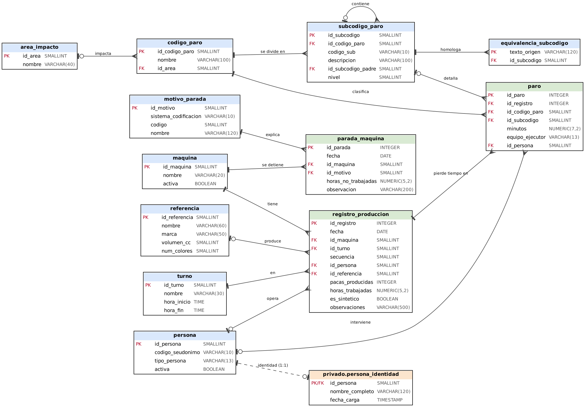

# 4. Modelo relacional (logico)

Derivado del MER: cada entidad se vuelve tabla; cada relacion 1:N pasa como llave foranea al lado "N"; la relacion recursiva es una FK a la misma tabla; la 1:1 PERSONA-identidad comparte la llave primaria. Notacion: pata de gallo. Diagrama: `docs/diagramas/modelo_logico.png`.



## Esquema (PK subrayada con `*`, FK con `#`)

```
maquina(*id_maquina, nombre, activa)
turno(*id_turno, nombre, hora_inicio, hora_fin)
area_impacto(*id_area, nombre)
codigo_paro(*id_codigo_paro, nombre, #id_area)
subcodigo_paro(*id_subcodigo, #id_codigo_paro, codigo_sub, descripcion, #id_subcodigo_padre, nivel)
equivalencia_subcodigo(*texto_origen, #id_subcodigo)
motivo_parada(*id_motivo, sistema_codificacion, codigo, nombre)
referencia(*id_referencia, nombre, marca, volumen_cc, num_colores)
persona(*id_persona, codigo_seudonimo, tipo_persona, activa)
privado.persona_identidad(*#id_persona, nombre_completo, fecha_carga)
registro_produccion(*id_registro, fecha, #id_maquina, #id_turno, secuencia, #id_persona, #id_referencia,
                    pacas_producidas, horas_trabajadas, es_sintetico, observaciones)
paro(*id_paro, #id_registro, #id_codigo_paro, #id_subcodigo, minutos, equipo_ejecutor, #id_persona)
parada_maquina(*id_parada, fecha, #id_maquina, #id_motivo, horas_no_trabajadas, observacion)
```

Llaves alternas (UNIQUE): `maquina.nombre`, `turno.nombre`, `codigo_paro.nombre`, `(subcodigo_paro.id_codigo_paro, codigo_sub)`, `(motivo_parada.sistema_codificacion, codigo)`, `referencia.nombre`, `persona.codigo_seudonimo`, `registro_produccion(fecha, id_maquina, id_turno, secuencia)`.

FK compuesta: `paro(id_subcodigo, id_codigo_paro) -> subcodigo_paro(id_subcodigo, id_codigo_paro)` garantiza que el subcodigo pertenece al codigo del paro.

## Politicas ON DELETE / ON UPDATE

| FK | ON DELETE | ON UPDATE | Justificacion |
|---|---|---|---|
| catalogos -> tablas de hechos (maquina, turno, referencia, codigo, motivo, area) | RESTRICT | CASCADE | Un catalogo con historia no se borra; si cambia su identificador se propaga |
| `paro.id_registro` | CASCADE | CASCADE | El paro no tiene sentido sin su registro |
| `registro_produccion.id_persona`, `paro.id_persona` | SET NULL | CASCADE | Si se borra a una persona (derecho de supresion) la produccion se conserva anonima |
| `subcodigo_paro.id_subcodigo_padre` | RESTRICT | CASCADE | No se puede borrar un sistema que tiene componentes |
| `equivalencia_subcodigo.id_subcodigo` | CASCADE | CASCADE | Es una tabla de apoyo que depende del subcodigo |
| `persona_identidad.id_persona` | CASCADE | CASCADE | Borrar a la persona borra su identidad real |
